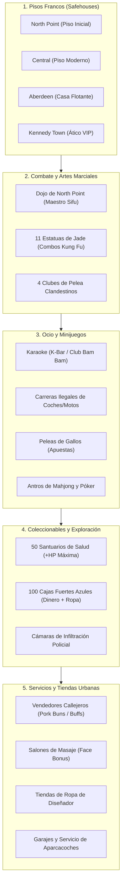
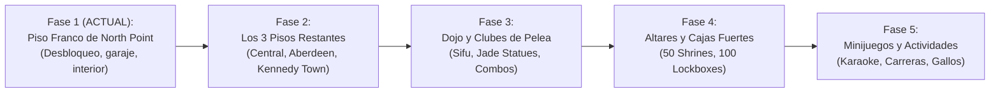

# ROADMAP DE INTEGRACIÓN: SLEEPING DOGS EN TRIAD WARS OFFLINE REVIVAL

> [!NOTE]
> Este documento establece el plan director, la especificación técnica y la arquitectura de ingeniería inversa para recuperar, adaptar e implementar progresivamente los sistemas, contenidos y actividades del modo historia de **Sleeping Dogs: Definitive Edition** dentro de **Triad Wars (v1.6.0.0, Changelist 541920, x64)**.

---

## 1. Justificación Técnica y Viabilidad

Ambos juegos fueron desarrollados por **United Front Games (UFG)** utilizando el mismo motor propietario: **TheoryEngine (x64)**.
Nuestras investigaciones en el ejecutable original [`TriadWars.exe`](file:///x:/projects/TriadWars/beta/TriadWars.exe) revelan que:
1. **Los interiores 3D originales siguen presentes** en los archivos de mapa (`GameHD.big`) y registrados en la tabla interna de streaming en `0x182DEF8`:
   - `Interior_SafehouseNP` (North Point Apartment)
   - `Interior_SafehouseCT` (Central Apartment)
   - `Interior_SafehouseAB` (Aberdeen Houseboat)
   - `Interior_SafehouseKT` (Kennedy Town Luxury Penthouse)
   - `Interior_DojoNP` (Master Sifu Martial Arts Dojo)
   - `Interior_Karaoke` (K-Bar Karaoke Club)
   - `Interior_BamBam` (Club Bam Bam)
   - `Interior_GDenCT` / `Interior_GDenNP` (Gambling Dens)
   - `Interior_ChuRest` (Golden Koi Restaurant)
   - `Interior_Hospital` (Central General Hospital)
2. **Las estructuras de datos de persistencia son idénticas**:
   - El archivo de guardado (`gamestate`) utiliza el formato binario `TC01` (versión 38, subversión 7 en Triad Wars vs versión 1, subversión 6 en Sleeping Dogs).
   - Las banderas de colección como `Collectible_Safehouse`, `Collectible_HealthShrine*`, `Collectible_LockBox*`, `DoorStateLocked` y `UndercoverSafehouse` existen de forma nativa en la tabla de tipos `MapBoolStat` del motor.
3. **El catálogo de modelos, física y animaciones es compatible**:
   - Esqueletos de personajes (`TSActor`), árboles de acción (`ActionTree`), físicas de vehículos y efectos visuales son directamente intercambiables.

---

## 2. Los Sistemas a Implementar (Catálogo Completo)

---

## 3. Desglose Detallado por Sistema

### 3.1. Los Pisos Francos (Safehouses)
En Sleeping Dogs, las casas son el refugio y centro de operaciones del jugador en los 4 distritos principales de Hong Kong.

| Piso Franco | Distrito | Características Únicas | Interior Engine | Coordenadas Puerta Ext. |
| :--- | :--- | :--- | :--- | :--- |
| **North Point** | North Point | Callejón junto al Night Market, estilo humilde | `Interior_SafehouseNP` | `X: 840.5, Y: -320.2, Z: 5.3` |
| **Central** | Central | Apartamento moderno de lujo, vistas a rascacielos | `Interior_SafehouseCT` | `X: -360.4, Y: -120.7, Z: 18.2` |
| **Aberdeen** | Aberdeen | Casa barco flotante tradicional con muelle | `Interior_SafehouseAB` | `X: -650.1, Y: -780.4, Z: 4.8` |
| **Kennedy Town** | Kennedy Town | Ático ultralujoso con terraza y jacuzzi | `Interior_SafehouseKT` | `X: -1150.3, Y: -120.5, Z: 25.1` |

#### Funcionalidades activas en cada piso:
1. **Cama:** Permite dormir, adelantar el ciclo de día/noche y restablecer la salud al 100%.
2. **Armario (*Wardrobe*):** Acceso inmediato a todas las prendas, trajes de negocios, ropa de calle y atuendos con perks comprados o desbloqueados.
3. **Frigorífico:** Bebida energética *Dragon Kick* que aumenta el daño de los golpes cuerpo a cuerpo en un 50% de forma temporal.
4. **Baño / Ducha:** Bonificación pasiva de regeneración de salud fuera de combate.
5. **Garaje / Valet Exterior:** Punto de recogida exterior donde solicitar cualquiera de los **247 vehículos** desbloqueados en el inventario.
6. **Mobiliario Coleccionable:** Decoraciones desbloqueables en tiendas de muebles (aire acondicionado, estatua de dragón, pósteres, televisor moderno, saco de boxeo).

---

### 3.2. Dojos de Artes Marciales y Clubes de Pelea
El combate cuerpo a cuerpo es el pilar central del universo de Sleeping Dogs.

1. **Dojo de North Point (El Maestro Sifu):**
   - **Localización:** Templo de artes marciales en North Point (`Interior_DojoNP`).
   - **Mecánica:** Al devolver las **11 Estatuas de Jade** repartidas por Hong Kong, el Maestro entrena al personaje desbloqueando nuevos combos letales de Kung Fu:
     - *Leg Sweep* (Barrido de piernas para derribar grupos).
     - *Arm Break* (Rotura de brazo para desarmar atacantes).
     - *Dim Mak / Stun Strike* (Golpe aturdidor para neutralizar matones grandes).
     - *Climbing Attack* (Ataque con impulso sobre paredes).
2. **Los 4 Clubes de Pelea Clandestinos (*Fight Clubs*):**
   - **Arenas:**
     - North Point (Ring callejero en un solar baldío).
     - Central (Aparcamiento subterráneo bajo vigilancia).
     - Aberdeen (Almacén del muelle de carga).
     - Kennedy Town (Club privado exclusivo).
   - **Mecánica:** 6 rondas consecutivas de enemigos de dificultad creciente (brawlers, grapplers, matones con cuchillos) con recompensas masivas de dinero sucio y reputación Triad Face.

---

### 3.3. Minijuegos y Actividades de Ocio

1. **Karaoke (K-Bar y Club Bam Bam):**
   - **Engine:** `Interior_Karaoke`, `Interior_BamBam`, banderas `EnableKaraoke` y pistas en `English(US).pck`.
   - **Mecánica:** Minijuego de afinación y ritmo con canciones clásicas de los 80 (como *Girls Just Want to Have Fun*, *I Ran*, *All Out of Love*).
2. **Carreras Callejeras Ilegales (*Street Racing*):**
   - **Circuitos:** 18 carreras divididas en clases (Clase C, B, A, Superdeportivos y Motocicletas).
   - **Integración:** Utiliza el catálogo de 247 vehículos desbloqueados en el servidor local.
3. **Peleas de Gallos (*Cockfighting*):**
   - **Arenas:** Ring de apuestas en Aberdeen y Kennedy Town.
   - **Mecánica:** Apuestas de alta volatilidad con dinero del jugador.
4. **Antros de Juego Clandestinos (*Gambling Dens*):**
   - **Localizaciones:** `Interior_GDenCT` y `Interior_GDenNP`.
   - **Mecánica:** Partidas de Póker Mahjong contra IA con apuestas de dinero sucio.

---

### 3.4. Coleccionables del Mundo Abierto

1. **50 Santuarios de Salud (*Health Shrines*):**
   - Mapeados en la geometría original (`Collectible_HealthShrineNP`, `CN`, `AB`, `KT`).
   - Por cada 5 santuarios visitados con rezo de incienso, la salud máxima del jugador aumenta permanentemente en un **+10%** (hasta un total de +100% de HP).
2. **100 Cajas Fuertes Azules (*Lockboxes*):**
   - Repartidas por tejados, callejones y alcantarillas.
   - Contienen dinero en efectivo y piezas exclusivas de vestuario.
3. **Cámaras de Seguridad (*SpyCams*):**
   - Dispositivos de vigilancia que el jugador puede hackear resolviendo un minijuego numérico.
   - Una vez hackeadas, se pueden visualizar desde el televisor del apartamento para arrestar a distribuidores de droga mediante llamadas a la policía.

---

### 3.5. Servicios Urbanos y Buffs de Combate

1. **Puestos de Comida Callejera (*Food Vendors*):**
   - Venta de *Pork Buns*, bollos al vapor, dim sum y fideos que otorgan regeneración continua de vida.
   - Puestos de té de hierbas que aumentan la resistencia física contra golpes.
2. **Salones de Masaje (*Massage Parlours*):**
   - Activan el buff `MassageParlourBuff_FaceEarned_Multiplier1`, haciendo que la barra de Face se llene el doble de rápido durante el combate.
3. **Tiendas de Ropa de Diseñador:**
   - 15 tiendas repartidas por los 4 distritos con ropa de distintas marcas (Hang Seng, J. J贴, aspiracionales y alta costura).

---

## 4. Fases de Ejecución

---

## 5. Fase 1: Implementación del Piso Franco de North Point

### Especificaciones de North Point:
- **Identificador de Interior:** `Interior_SafehouseNP`
- **Coordenadas de la Entrada Exterior:**
  - `X: 840.50`
  - `Y: -320.20`
  - `Z: 5.30`
- **Coordenadas del Garaje / Valet:**
  - `X: 835.00`
  - `Y: -328.00`
  - `Z: 5.00`
- **Coordenadas del Interior del Piso:**
  - `X: 843.00`
  - `Y: -314.50`
  - `Z: 5.50`
- **Banderas de Servidor a Activar en `state.json`:**
  - `SafehouseUnlocked = 1`
  - `UndercoverSafehouse = 1`
  - `Collectible_Safehouse: { "SafehouseNP": true }`
  - `DoorStateLocked: { "Door_SafehouseNP": false }`
- **Punto de Reaparición (*Spawn Point / Restore Location*):**
  - Configurado en `get_closest_restore_location` hacia `RestoreType_Safehouse` en North Point.
